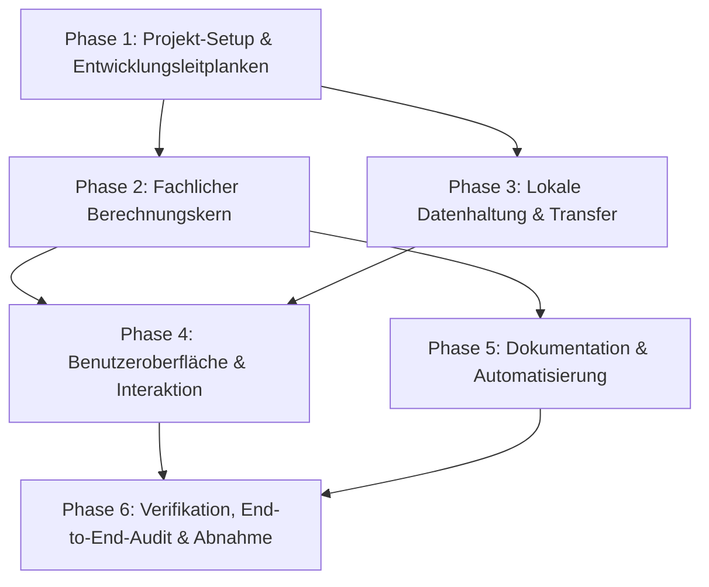

# Roadmap: CashflowPlanner

Diese Roadmap strukturiert die vollständige Umsetzung des **CashflowPlanner** auf Basis der Vorgaben aus [Konzept.md](Konzept.md).

Die Arbeitspakete sind bewusst so dimensioniert, dass sie **in sich geschlossene, überprüfbare Meilensteine** darstellen: weder zu grobgranulare Blöcke (wie „Gesamte UI bauen“) noch triviale Einzelschritte (wie einzelne HTML-Tags einfügen). Jedes Paket besitzt klare Liefergegenstände und Prüfkriterien.

---

## Phasenübersicht

---

## Phase 1: Projekt-Setup & Entwicklungsleitplanken (Bootstrap & Tooling)

Ziel: Ein solides, dependency-armes Projektfundament mit standardisierten Entwicklerwerkzeugen, strikten Qualitätsregeln und Agenten-Vorgaben bereitstellen.

### 1.1 Projektstruktur, Basiskonfiguration & Dev-Server
- **Ziel:** Initiales Repository-Layout nach Konzept Kap. 8 anlegen, `package.json` mit exakten Skripten konfigurieren und einen leichtgewichtigen lokalen Entwicklungsserver für ES Modules bereitstellen.
- **Betroffene Dateien:**
  - `package.json`
  - `.gitignore`
  - `scripts/dev-server.mjs`
  - `web/index.html` (Basisskelett)
- **Kriterien & Prüfpunkte:**
  - `npm run dev` startet einen lokalen Node-HTTP-Server mit korrekten MIME-Types (insbesondere für `.js`-Module) ohne externe Bundler oder Frameworks.
  - Verzeichnisstruktur für `web/`, `tests/`, `scripts/`, `docs/` und `.agents/rules/` existiert.

### 1.2 Agenten-Regelwerk & Richtlinien
- **Ziel:** Verbindliche Leitplanken für zukünftige agentische Arbeiten definieren, um Invarianten, Minimalismus und Konsistenz sicherzustellen.
- **Betroffene Dateien:**
  - `AGENTS.md` (Projektstamm)
  - `.agents/rules/domain.md` (Invarianzregeln, Cent-Arithmetik, Rückwärtsrechnung)
  - `.agents/rules/code-quality.md` (KISS, YAGNI, Modularität, pure functions)
  - `.agents/rules/ui.md` (Designkriterien, Zugänglichkeit, deutsche Fachbegriffe)
- **Kriterien & Prüfpunkte:**
  - Alle Vorgaben aus Konzept Kap. 9 und 10 sind vollständig abgedeckt und miteinander verlinkt.

### 1.3 Test-Infrastruktur & ESLint-Qualitätsprüfung
- **Ziel:** Node.js Built-in Test-Runner und strikte ESLint-Konfiguration einrichten.
- **Betroffene Dateien:**
  - `eslint.config.js`
  - `package.json` (Scripts: `lint`, `test`, `test:coverage`, `verify`)
  - `tests/sanity.test.js` (Initialer Smoke-Test)
- **Kriterien & Prüfpunkte:**
  - `npm run lint` prüft fehlerfrei (Warnungen werden als Fehler gewertet).
  - `npm test` führt Node-Bordmittel-Tests (`node:test`) ohne externe Testbibliotheken aus.

---

## Phase 2: Fachlicher Berechnungskern (Finanzmathematik & Pure Functions)

Ziel: Den mathematischen Kern vollständig unabhängig vom DOM, deterministisch, centgenau und umfassend automatisiert getestet implementieren.

### 2.1 Kalender- & Zeitmodell
- **Ziel:** Monatsgenaue Zeitrechnung, Umrechnung zwischen Lebensalter und Kalendermonaten sowie Fälligkeitsberechnungen bereitstellen.
- **Betroffene Dateien:**
  - `web/js/domain/calendar.js`
  - `tests/calendar.test.js`
- **Kriterien & Prüfpunkte:**
  - Eindeutige Monatsindizierung (Start beim aktuellen Monat $t=0$).
  - Korrekte Behandlung von Jahresgrenzen, Schaltjahren und zeitlichem Planungshorizont.
  - Abdeckung aller Tests für Monatsarithmetik.

### 2.2 Ziele, Fälligkeiten & Ereigniserzeugung
- **Ziel:** Verwaltung der finanziellen Ziele, Aufspaltung jährlicher Ziele in diskrete Monatsereignisse und Berücksichtigung von zeitlichem Spielraum.
- **Betroffene Dateien:**
  - `web/js/domain/goals.js`
  - `tests/goals.test.js`
- **Kriterien & Prüfpunkte:**
  - Erzeugung von monatlichen Ausgabensummen $E[t]$.
- Reguläre jährliche Fälligkeiten werden ab Erstfälligkeit exakt alle 12 Monate bis zum Planungshorizont erzeugt.
- Vergangene, noch gespeicherte Ziele werden als offene Ausgabe im aktuellen Monat berücksichtigt; bei jährlichen Zielen bleiben die künftigen ursprünglichen Kalendermonate erhalten.
  - Ziele außerhalb des Planungshorizonts werden nicht berücksichtigt.
  - Validierung von Zielbeträgen (Cent-Integer, positive Werte) und Namen.

### 2.3 Deterministische Rückwärtsberechnung & Liquiditätsprüfung
- **Ziel:** Kernalgorithmus zur Bestimmung des minimal erforderlichen Cashbestands $F[t]$ sowie der aktuellen Liquiditätssituation implementieren.
- **Betroffene Dateien:**
  - `web/js/domain/liquidity.js`
  - `tests/liquidity.test.js`
- **Kriterien & Prüfpunkte:**
  - Berechnung $F[H] = R$ und rückwärts $F[t-1] = \max(R, F[t] + E[t] - M)$.
  - Ermittlung von `Cash_erforderlich_heute = E[0] + F[0]`.
  - Korrekte Ableitung von `Finanzierungslücke_heute` und `Maximal_freigebbar_heute`.
  - Exakte Cent-Arithmetik (keine Gleitkomma-Ungenauigkeiten).

### 2.4 Monatsplaner & Szenarien (Szenario A & B, zeitliche Flexibilität)
- **Ziel:** Monatlichen Spar- und Allokationsverlauf berechnen sowie Szenario A (Bestand halten) und B (freigegebenen Überschuss sofort entnehmen) abbilden.
- **Betroffene Dateien:**
  - `web/js/domain/scenarios.js`
  - `tests/scenarios.test.js`
- **Kriterien & Prüfpunkte:**
  - Sparrate: $\text{Sparrate}[t] = \max(0, F[t] + E[t] - \text{Cash}[t-1])$, mit $0 \le \text{Sparrate}[t] \le M$.
  - Langfristig verfügbarer Monatsbetrag: $M - \text{Sparrate}[t]$.
  - Prüfung bei Unterdeckung: Erkennung des ersten kritischen Monats und Markierung als nicht finanzierbar (kein Vorgaukeln gültiger Sparraten).
  - Alternative Terminverschiebung: Bei Unterdeckung Prüfung, ob die erlaubten Spielräume ($\pm N$ Monate) rechnerisch ausreichen.

### 2.5 Referenzszenario & Mathematische Invarianten-Tests
- **Ziel:** Implementierung des im Konzept Kap. 12.3 spezifizierten Referenzszenarios sowie systematischer Invariantenprüfungen.
- **Betroffene Dateien:**
  - `tests/fixtures/scenarios.json`
  - `tests/liquidity.test.js` / `tests/scenarios.test.js`
- **Kriterien & Prüfpunkte:**
  - Referenzfall (40.000 € Start, 500 €/Monat, 16 Jahre, 5.000 € Urlaub p.a., 40.000 € Auto nach 6 Jahren, 20.000 € Auto nach 16 Jahren) liefert exakt 4.000 € Lücke und 44.000 € Mindeststartbestand.
  - Invarianten: Monotonie (mehr Cash $\to$ niemals schlechter), Cashbilanz (Summe Einzahlungen - Ausgaben = Endbestand - Anfangsbestand), $100\%$ deterministisch.
  - Testabdeckung des Domain-Kerns $\ge 90\%$.

---

## Phase 3: Lokale Datenhaltung & Transfer (LocalStorage & JSON)

Ziel: Robuste, manipulationssichere Speicherung aller Eingaben im Browser sowie validierter JSON-Import und -Export.

### 3.1 LocalStorage-Adapter & Datenmodell-Versionierung
- **Ziel:** Laden und Speichern von Einstellungen, Zielen und tatsächlichem Cashbestand mit Aktualisierungszeitstempel.
- **Betroffene Dateien:**
  - `web/js/data/storage.js`
  - `tests/storage.test.js`
- **Kriterien & Prüfpunkte:**
  - Schema-Versionierung für spätere Migrationen.
  - Erkennung veralteter Bestandsdaten (zur Anzeige von Aktualisierungshinweisen).
  - Fehlerresistenz bei deaktiviertem oder vollem LocalStorage.

### 3.2 JSON-Export & sicherer JSON-Import
- **Ziel:** Vollständige, verlustfreie Sicherung als JSON-Datei und strukturvalidierter Import mit Benutzerbestätigung.
- **Betroffene Dateien:**
  - `web/js/data/import-export.js`
  - `tests/data-format.test.js`
- **Kriterien & Prüfpunkte:**
  - Validierung aller Felder, Datentypen, ID-Eindeutigkeiten und Cent-Grenzen.
  - Sichere Ablehnung manipulierter oder korrupter JSON-Dateien ohne unvollständige Datenübernahme.
  - Kein Einsatz von `eval` oder unsicherer HTML-Injektion.

---

## Phase 4: Benutzeroberfläche & Interaktion (Vanilla JS, CSS & Responsive UI)

Ziel: Ein klares, deutschsprachiges, professionelles und barrierearmes Interface mit reaktiver Aktualisierung, interaktivem SVG-Diagramm und Monatsvorschau.

### 4.1 Basis-Layout, CSS-Design-System & Accessibility
- **Ziel:** Modernes, sachliches Finanz-Styling (heller Hintergrund, Grün für gedeckt, Rot für Lücke, klare Hierarchie) und responsives Grid/Flex-Layout aufsetzen.
- **Betroffene Dateien:**
  - `web/index.html`
  - `web/css/main.css`
- **Kriterien & Prüfpunkte:**
  - Vollständiges Responsive Design für Smartphone, Tablet und Desktop.
  - Keine externen CDNs/Fonts, rein lokale CSS-Assets.
  - Semantisches HTML, klare ARIA-Attribute und vollständige Tastaturbedienbarkeit.

### 4.2 Eingabebereich „Ausgangslage“ & Reaktivitäts-Pipeline
- **Ziel:** Steuerung der Parameter (Cashbestand, Monatsbetrag, Mindestreserve, Alter, Planungshorizont) mit sofortiger automatischer Neuberechnung bei Eingaben.
- **Betroffene Dateien:**
  - `web/js/ui/settings-form.js` (oder Integration in `main.js`)
  - `web/js/main.js` (App-Controller & Event-Bus/State-Dispatch)
- **Kriterien & Prüfpunkte:**
  - Formatiertes Euro-Währungsformat bei Fokusverlust/Anzeige, saubere Cent-Konvertierung.
  - Unmittelbare Validierungsrückmeldungen ohne störende Alert-Dialoge.
  - Automatisches Speichern im LocalStorage bei jeder gültigen Änderung.

### 4.3 Zielverwaltung („Finanzielle Ziele“ CRUD-UI)
- **Ziel:** Liste aller Ziele mit Statusanzeige sowie einfaches Dialog-/Formularmodul zum Hinzufügen, Bearbeiten und Löschen.
- **Betroffene Dateien:**
  - `web/js/ui/goals-form.js`
- **Kriterien & Prüfpunkte:**
  - Schnelle Erfassung mit wenigen Pflichtfeldern (Name, Betrag, Fälligkeit, Wiederholung, Spielraum).
  - Chronologische Sortierung der Zielliste.
- Eine eigene Zielansicht mit dauerhaft erreichbarer Hinzufügen-Aktion, Suche und Seitenaufteilung bleibt auch mit 100 Zielen bedienbar.
  - Sichere DOM-Erzeugung ohne XSS-Risiko.

### 4.4 Finanzielle Auswertung & KPI-Zusammenfassung
- **Ziel:** Prominente Darstellung der vier Kernkennzahlen und eines dynamischen, leicht verständlichen Erklärungstexts.
- **Betroffene Dateien:**
  - `web/js/ui/summary.js`
- **Kriterien & Prüfpunkte:**
  - Anzeige: Erforderlicher Cashbestand, Überschuss/Lücke, nächste Monatszuführung, freier Betrag für langfristige Anlagen.
  - Farbcodierung (Grün = finanzierbar, Rot = Finanzierungslücke).
  - Verständlicher Erklärungstext in Alltagssprache ohne Anlageberatung.

### 4.5 Interaktives SVG-Diagramm
- **Ziel:** Visualisierung des Cashverlaufs über der Lebensaltersachse mittels nativem SVG.
- **Betroffene Dateien:**
  - `web/js/ui/chart.js`
- **Kriterien & Prüfpunkte:**
  - X-Achse: Lebensalter in Jahren; Y-Achse: Eurobeträge.
  - Kurven für prognostizierten Cashbestand (Szenario A & B umschaltbar) und minimal erforderlichen Cashbestand $F[t]$.
  - Horizontale Linie für Mindestreserve $R$ und Markierungen für Ziel-Ausgaben.
  - Rote Hervorhebung von Unterdeckungsphasen.
  - Interaktive Tooltips bei Hover/Fokus (Monat, Alter, Bestand, Ausgaben).

### 4.6 Monatliche Sparvorschau & Beispieldaten-Funktion
- **Ziel:** Tabelle der kommenden 12 Monate für Cash-Zuführung vs. freie Mittel sowie One-Click-Beispieldaten für Erstnutzer.
- **Betroffene Dateien:**
  - `web/js/ui/monthly-plan.js`
  - `web/js/data/sample-data.js`
- **Kriterien & Prüfpunkte:**
  - Monatstabelle zeigt: Monat, in Cash zurücklegen, frei für langfristige Anlagen, prognostizierter Cash-Endstand.
  - Bei nicht finanzierbarem Plan wird kein irreführender Sparplan angezeigt, sondern ein klarer Engpass-Hinweis.
  - Beispieldatenbutton füllt die Anwendung sofort mit einem realistischen Szenario zum Ausprobieren.

---

## Phase 5: Dokumentation & Automatisierung

Ziel: Vollständige technische und fachliche Dokumentation sowie Skripte zur automatisierten Synchronisation und Konsistenzprüfung.

### 5.1 Fach- und Architekturdokumentation
- **Ziel:** Erstellung der verbindlichen Referenzdokumente für Fachlichkeit, Architektur, Algorithmus und Datenformat.
- **Betroffene Dateien:**
  - `docs/PRODUCT.md`
  - `docs/ARCHITECTURE.md`
  - `docs/ALGORITHM.md`
  - `docs/DATA_FORMAT.md`
  - `README.md`
- **Kriterien & Prüfpunkte:**
  - Exakte Beschreibung von Zeitmodell, Rückwärtsrechnung und Nicht-Zielen.
  - Schnelleinstieg und Ausführungsanleitung in der `README.md`.

### 5.2 Automatisierte Dokumentations-Synchronisation & Check-Skripte
- **Ziel:** Automatische Generierung von Beispielszenarien aus den Test-Fixtures und Validierung aller Dokumentationsverweise.
- **Betroffene Dateien:**
  - `scripts/docs-sync.mjs`
  - `scripts/docs-check.mjs`
  - `docs/EXAMPLES.md` (automatisch generiert)
- **Kriterien & Prüfpunkte:**
  - `npm run docs:sync` regeneriert `docs/EXAMPLES.md` deterministisch aus `tests/fixtures/scenarios.json`.
  - `npm run docs:check` prüft das Vorhandensein aller Dokumente, gültige interne Verweise und Aktualität von `EXAMPLES.md` (Exit-Code 1 bei Abweichungen).

---

## Phase 6: Verifikation, End-to-End-Audit & Abnahme

Ziel: Abschließende Prüfung aller 28 Abnahmekriterien aus Konzept Kap. 18, Code-Qualitätsaudit und finale Abnahme.

### 6.1 Vollständige Qualitäts-Pipeline (`npm run verify`)
- **Ziel:** Bündelung aller Prüfschritte in einem zentralen Befehl.
- **Betroffene Dateien:**
  - `package.json` (`npm run verify` $\to$ Linting + Tests + Coverage + Docs-Check)
- **Kriterien & Prüfpunkte:**
  - `npm run verify` läuft fehlerfrei durch.
  - Testabdeckung im Domain-Bereich $\ge 90\%$.
  - Null ESLint-Warnungen oder -Fehler.

### 6.2 Browser-Smoke-Testing & Barrierefreiheit
- **Ziel:** Visuelle und funktionale Überprüfung der Anwendung im realen Browser.
- **Prüfpunkte:**
  - Anlegen, Bearbeiten, Löschen von Zielen.
  - Umschalten zwischen Szenario A und B.
  - Import und Export einer Testdatei.
  - Darstellung auf mobilen Auflösungen (Responsive Viewport).
  - Navigation per Tab-Taste.

### 6.3 Fachliches & Technisches Audit
- **Ziel:** Unabhängige Prüfung der 28 fachlichen Abnahmekriterien (Konzept Kap. 18) und Bereinigung von übrigem Test- oder Debug-Code.
- **Prüfpunkte:**
  - Abgleich gegen die 28 Punkte der Abnahmekriterien.
  - Sicherstellung, dass keine unerwünschten Features (Kredit, Depot, Zinsen, KI, etc.) enthalten sind.
  - Bereinigung von Konsolen-Logs und temporären Hilfsdateien.

---

## Fortschrittsübersicht

| Phase | Paket-ID | Bezeichnung | Status |
|---|---|---|---|
| 1 | 1.1 | Projektstruktur & Dev-Server | [x] Erledigt |
| 1 | 1.2 | Agenten-Regelwerk | [x] Erledigt |
| 1 | 1.3 | Test-Infrastruktur & ESLint | [x] Erledigt |
| 2 | 2.1 | Kalender- & Zeitmodell | [x] Erledigt |
| 2 | 2.2 | Ziele & Fälligkeiten | [x] Erledigt |
| 2 | 2.3 | Rückwärtsrechnung & Liquidität | [x] Erledigt |
| 2 | 2.4 | Monatsplaner & Szenarien | [x] Erledigt |
| 2 | 2.5 | Referenzszenario & Invarianten-Tests | [x] Erledigt |
| 3 | 3.1 | LocalStorage & Versionierung | [x] Erledigt |
| 3 | 3.2 | JSON-Export & -Import | [x] Erledigt |
| 4 | 4.1 | Design-System & Responsive Layout | [x] Erledigt |
| 4 | 4.2 | Eingabebereich „Ausgangslage“ | [x] Erledigt |
| 4 | 4.3 | Zielverwaltung (CRUD) | [x] Erledigt |
| 4 | 4.4 | Finanzielle Auswertung & KPIs | [x] Erledigt |
| 4 | 4.5 | Interaktives SVG-Diagramm | [x] Erledigt |
| 4 | 4.6 | Monatliche Sparvorschau & Beispieldaten | [x] Erledigt |
| 5 | 5.1 | Fach- und Architekturdokumentation | [x] Erledigt |
| 5 | 5.2 | Doku-Synchronisation & Check-Skripte | [x] Erledigt |
| 6 | 6.1 | Vollständige Pipeline (`npm run verify`) | [x] Erledigt |
| 6 | 6.2 | Browser- & Usability-Verifikation | [x] Erledigt |
| 6 | 6.3 | Fachliches & Technisches Audit | [x] Erledigt |
| 7 | 7.1 | Jährliche Inflation für Zielzahlungen | [x] Erledigt |
| 7 | 7.2 | Optionaler Endmonat für jährliche Ziele | [x] Erledigt |
| 7 | 7.3 | Ein Cashplan, feste Monatsrate und Alter bei Monat/Jahr | [x] Erledigt |
| 7 | 7.4 | Mindestreserve steigt mit Inflation | [x] Erledigt |

## Erweiterung 7.1: Inflation

- Eingebbarer jährlicher Satz mit 2 % Vorgabe; 0 % lässt Zielbeträge unverändert.
- Künftige Zielzahlungen werden bis zum tatsächlichen Zahlungsmonat hochgerechnet; heute überfällige Zahlungen bleiben beim eingegebenen Betrag.
- Alte gespeicherte Pläne und JSON-Dateien ohne Inflationsfeld werden mit 2 % geladen. Monatsbudget bleibt nominal.
- Fachliche Tests, Dokumentation und Browserprüfung sind ergänzt.

## Erweiterung 7.2: Endmonat für jährliche Ziele

- Im Zielformular kann für jährliche Ziele ein letzter Fälligkeitsmonat eingegeben werden; ohne Endmonat laufen sie bis zum Planungshorizont.
- Der Endmonat zählt einschließlich. Bei alten, inzwischen beendeten Zielreihen wird weiterhin genau eine offene Zahlung heute nachgeholt.
- Theoretisch verschobene Zahlungen bleiben innerhalb des Endmonats; heute fällige Zahlungen werden nicht verschoben.
- Bestehende gespeicherte Ziele und JSON-Dateien ohne `endMonth` bleiben gültig und erhalten beim Laden `null`.
- Fachliche Tests, Dokumentation und Browserprüfung sind ergänzt.

## Erweiterung 7.3: Vereinfachter Zeitplan

- Ein einziger Cashplan verwendet die gespeicherten Fälligkeiten und baut Cash bei finanzierbaren Plänen so spät wie möglich auf. Frühere Freigabe- und Verschiebevarianten aus den Paketen 2.4 und 4.5 sind entfernt; `flexMonths` bleibt nur für alte JSON-Dateien erhalten.
- Der monatlich verfügbare Betrag bleibt auch bei positiver Inflation über den gesamten Zeitraum nominal konstant.
- Die Oberfläche trennt aktuelle Ausgaben von langfristigem Modellbedarf und erstem Engpass; bei Unterdeckung zeigt sie einen Verlauf mit voller Monatszuführung statt eines als gültig ausgegebenen Sparplans.
- Monat/Jahr und das daraus näherungsweise berechnete Alter stehen bei Zielterminen und Zeitplan zusammen.
- Die private Importdatei in `temp/` wurde zur fachlichen Prüfung gelesen, aber nicht eingecheckt.

## Erweiterung 7.4: Mindestreserve mit Inflation

- Bei eingestellter jährlicher Inflation wächst neben künftigen Zielbeträgen auch die Mindestreserve monatsgenau mit (`(1 + p/100)^(t/12)`).
- Die Rückwärtsrechnung garantiert an jedem Monatsende `Cash[t] >= R[t]`.
- Im SVG-Diagramm folgt die Reservelinie bei positiver Inflation der Kurve der anwachsenden Mindestreserve.
- Der monatlich verfügbare Betrag bleibt weiterhin nominal konstant.
